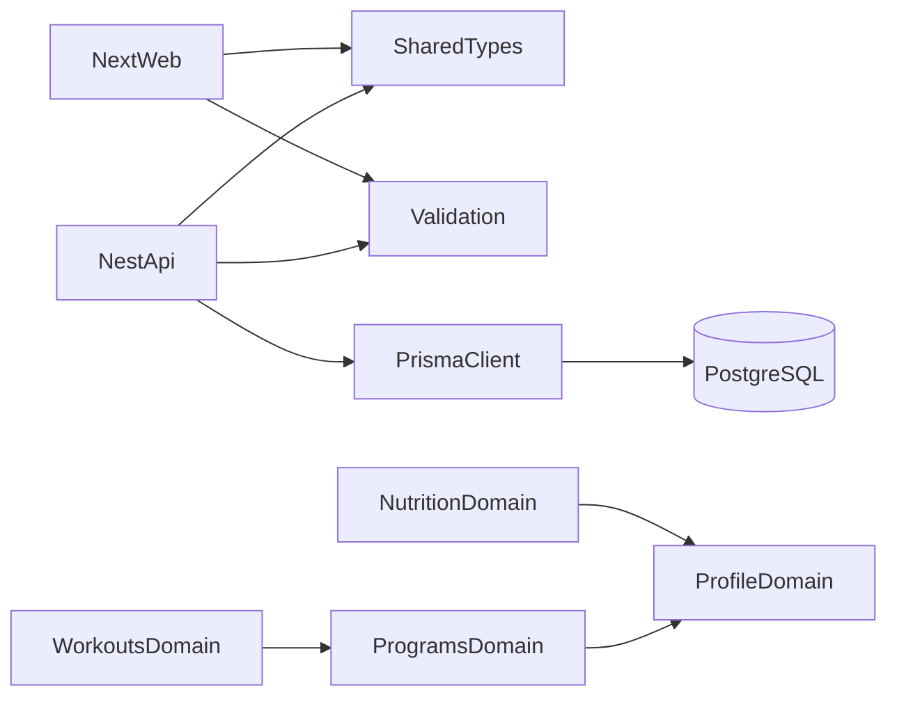

# Architecture

YS Fitness is a pnpm/Turborepo monorepo with a NestJS REST API, a Next.js web app, PostgreSQL through Prisma, and shared contract packages.

## Domain boundaries

Questionnaire input, derived targets, and generated plans are separate domain concerns:

- **Profile data** records facts supplied by the user: name, date of birth, calculation sex, height, activity level, goal, restrictions, and measurement history. Name is optional on older profiles and required for new onboarding saves. After onboarding, `PATCH /users/me/profile` may update height, append a weight measurement, and write experience, design goal, and training frequency on `OnboardingResponses`; the profile page edits all three and asks for confirmation before saving a changed experience or frequency, since those can reassign the program. It does not change name, date of birth, program track, or calculation sex. `GET /users/me/measurements` returns the latest 1000 weights for the chart (`weightKg` as a number) and the first-ever measurement separately, so a history longer than 1000 rows still has a real starting weight. `POST /users/me/measurements` appends one weight. Both require a JWT and do not require a subscription. `GET` and `POST /users/me/progress-photos` list and add up to 8 progress photos the same way: JPEG, PNG, or WebP, at most 400 KB and 1024 pixels on the longest edge, with the server setting the timestamp. The server decodes the upload, stores a JPEG on local disk under `PROGRESS_PHOTO_DIR` (default `storage/progress-photos`), and keeps only a relative storage key plus width and height in Postgres. `GET /users/me/progress-photos/:photoId` returns that JPEG to the owner, and `DELETE` removes the file before the row. A file that cannot be removed leaves the row in place and returns 500 `PHOTO_DELETE_FAILED`. Upgrading a database that still has `image` bytea adds the file columns first; `pnpm --filter api backfill:progress-photos` copies those bytes and records a key only after the file reads back, and a later migration drops `image` only when every row has a file. The insert locks the user row, then counts, so two uploads cannot both pass the cap. Local disk is not a backup. An object-storage adapter can replace `LocalProgressPhotoStorage` later without changing the photo service. `GET /workouts/strength` returns each exercise's earliest and latest loaded weight from the full history. It requires a JWT and does not require a subscription. The web app converts an iPhone HEIC or HEIF file to JPEG before that request. `GET /programs/assigned` still requires an active subscription; the progress page hides the training card when that request is forbidden or empty, and still shows weight. `/progress` is protected like `/dashboard` and `/profile`: the proxy sends a signed-out visitor to login and an incomplete session to onboarding, and `AuthGate` does the same when onboarding is incomplete. `/training` and `/workout` are in the proxy onboarding redirect but not in that `AuthGate` check.
- **Questionnaire input** is stored on `OnboardingResponses`, one row per user, separate from `UserProfile`. It holds the raw quiz (`programTrack`, body photos, physique level, design goal, experience, frequency, focus areas, nutrition habits). Nutrition and programs may read it later; they must not write it. The users module writes it on onboarding submit and on profile PATCH.
- **Mail** (`apps/api/src/mail`) sends transactional email through Nodemailer over SMTP. Today that is the plain-text welcome sent after registration, the password reset link, and a "password changed" notice. Auth calls it without awaiting, and `MailService` never throws, so a mail outage cannot affect sign-up or change what a password-reset request answers. Password reset (`PasswordResetService`) stores only the SHA-256 of a random token in `password_reset_tokens`; a token lives 30 minutes, works once, and a new request replaces earlier unused ones. A request is answered the same way (204) for unknown, inactive, or rate-limited emails, and the same account gets at most one link per minute. Spending a token sets the argon2 hash, revokes every `AuthSession` and refresh token for the user in the same transaction (the JWT strategy already rejects revoked sessions, so access tokens stop working at once), and then sends the notice. It is disabled when `SMTP_HOST` is unset. It does not verify addresses.
- **Nutrition** calculates and stores versioned calorie and macro targets from profile data. It must not add calculated values to `UserProfile`.
- **Programs** assigns one of the trainer's existing templates from onboarding answers. It does not algorithmically generate a program. A `WorkoutProgram` stores only the user and the template id, so a later template edit is what assigned clients see. It does not copy days into the profile or invent a program when no template matches. `ProgramTemplate.name` is the CSV subtitle, not a marketing title invented in code. Client screens title a program from its accent and show level and frequency separately; `code` stays on the API and is not the client title. `Exercise.name` is the trainer's Ukrainian name and `Exercise.nameEn` is the English name from the CSV library's fifth column; both are returned on every exercise, and the web app picks one by locale in `apps/web/lib/exercise-name.ts`, falling back to the Ukrainian name when `nameEn` is empty. A template row may carry an abs add-on flag. It only makes the workout screen show a fixed, disabled abs card after that exercise (every workout also starts with a fixed joint warm-up card). Neither card is numbered, counted, or logged, and no history or progression is stored for them. `ExerciseSeedCheck` runs once at API startup. It refuses to boot when there are no exercises or no active templates, and when any exercise still at the migration placeholder of 12–12 is used by an active template. Rows on a retired template do not affect the check. Abs add-on flags stay display data and are not a seed signal. `db:migrate` and `db:seed` are one deployment step: the reps migration writes those placeholders, and the seed replaces them. Profile PATCH reassigns or unassigns only through `ProgramsService` in the same transaction as the profile writes; users code does not touch `workout_programs` directly. Male and female templates are both seeded. Matching uses program track, level, frequency, and accent, and stays empty when that combination has no active template. The reps shown for a program day, and the reps used for a weight recommendation, come from the template exercise row so each track keeps its own range. When the assigned block is finished (`completed` reaches `expected`), `GET /programs/promotion` offers the next template: one level up at the same gender, frequency, and accent, or, for an advanced program, the other advanced accents at the same gender and frequency. `POST /programs/promotion` with that template id updates experience and focus on `OnboardingResponses` and assigns the template in one serializable transaction, so `assignedAt` moves forward and the cycle count starts at 0. History is kept. An id outside the current offer is `400` `PROMOTION_NOT_AVAILABLE` and rolls back. The web sheet on the dashboard and the workout completion screen reads that offer; dismissing it does not write.
- **Workouts** records a completed program day on `WorkoutLog` and the sets actually performed on `WorkoutLogSet` (`templateId`, `dayNumber`, and `exerciseId` are stored as they were at log time). The next day rotates forward from the latest log for the assigned template since `assignedAt`, wrapping after `frequencyPerWeek`; a reassignment starts again at day 1. `GET /programs/me` returns `dayLogCounts` (how many times each `dayNumber` was logged for that template since `assignedAt`) and `programProgress`, whose `completed` value is the sum of those counts and whose `expected` value is `frequencyPerWeek × 8`. Each returned set carries a weight recommendation from that exercise's last set in the log, compared with its rep range; the session shows it only as text. The completion screen lists every exercise submitted in that session, with that session's sets and the previous session's sets when a prior log matches the same template, day, and exercise. It does not show duration. `/training` lists every assigned day and that cycle count. Day cards start collapsed except the next day, and only that day opens `/workout`. The dashboard training card links to `/training`; the hero start button still opens `/workout`. Between the banner and the day cards it shows a week strip that expands into a month grid, fed by `GET /workouts/calendar` (logs in a `[from, to)` range of at most 43 days). Day boundaries are the browser's local midnights, computed in `apps/web/lib/calendar.ts`, not the profile timezone. Recommended training weekdays are a fixed client-side table keyed by `frequencyPerWeek` (`apps/web/lib/training-schedule.ts`), applied from `assignedAt` onward.

- **Coach** is an `ADMIN` view. History reads do not write those rows. `POST /coach/clients/:userId/archive` sets that client's `User.isActive` to false and revokes their sessions and refresh tokens in one transaction. `POST /coach/clients/:userId/restore` sets `isActive` back to true and does not create a session or touch subscriptions. Programs, logs, subscriptions, measurements, photos, and the email stay. Repeating either call succeeds and does not rewrite an account that is already in that state. `GET /coach/programs/:templateId/clients` lists clients whose current `WorkoutProgram` uses that template, including archived clients. `GET /coach/clients` lists every client account, with `archived` when they can no longer sign in. `GET /coach/clients/:userId` returns one client's profile, onboarding answers, assigned program, and latest subscription. The same client check gates `.../workouts`, `.../measurements`, `.../strength`, and `.../progress-photos`. A non-client id is `404` `CLIENT_NOT_FOUND` and those reads do not run. Workout pages keep every saved log, including sessions from an earlier template. Photo bytes are a private uncached JPEG for that client only. The module does not write those tables and does not expire lapsed subscriptions. It does not return password hashes, sessions, tokens, provider references, the grant actor, health restrictions, or photo storage keys. The web routes are `/coach` and `/coach/clients/:userId`. `ys_web_session=coach` is a navigation hint for the proxy and gates. The API never reads it. The user role `ADMIN` is the platform owner. `ProgramOrigin.TRAINER` remains the origin of a coach-authored template and is not a user role.

Web onboarding asks program track (female/male visual branch) once. That choice writes `programTrack` on `OnboardingResponses` and also fills `biologicalSexForCalculation` on the persisted profile. See [ADR 003](docs/adr/003-onboarding-program-track-and-bmr-sex.md).

Users who completed onboarding before `OnboardingResponses` existed have no row. `GET /users/me/onboarding-responses` returning `{ responses: null }` is expected for them. Do not backfill invented answers.

A domain may read another domain through an explicit service or public contract. It must not mutate another domain's tables directly. New calculated outputs should retain enough input/version metadata to explain when and how they were produced.

## Backend modules

NestJS modules own their HTTP endpoints, domain logic, and data access. Controllers remain thin. Zod request schemas originate in `@repo/validation`; public response shapes originate in `@repo/shared-types`. Prisma-generated types stay inside `apps/api`.

Prisma access belongs in a domain service for simple modules or a repository when queries become nontrivial or need focused unit testing. Controllers never inject `PrismaService`.

See [CONTRIBUTING.md](CONTRIBUTING.md) for the standard module tree.

## Authentication sessions

Every login creates an `AuthSession`. Access JWTs contain only identity and authorization claims: `sub`, `sessionId`, `role`, `iat`, and `exp`.

Refresh JWTs are one-time credentials. The API stores only their SHA-256 digests in `AuthRefreshToken` records:

1. A valid refresh consumes the current token record.
2. A replacement token is issued in the same transaction.
3. Presenting a consumed token proves that a credential has been copied or replayed.
4. The whole session and its token family are revoked because the server cannot identify which holder is legitimate.

Password hashing uses Argon2. Refresh-token digests use SHA-256 because refresh tokens already have high cryptographic entropy and require indexed lookup.

Browser refresh tokens use HttpOnly cookies with origin checks and SameSite protection. `SameSite=None` additionally requires a signed double-submit CSRF token. Native clients receive refresh tokens in the response body for secure device storage.

Decision details are recorded in [ADR 001](docs/adr/001-refresh-token-rotation.md).

## Shared package boundaries

### `@repo/shared-types`

Contains public API request/response/error contracts used across applications. It must never export:

- Prisma models, generated enums, or `Prisma.Decimal`
- database-only fields such as password or token hashes
- internal persistence shapes

API services map persistence results into these contracts at the boundary.

### `@repo/validation`

Contains reusable Zod schemas and their inferred input types. The API uses them for runtime request validation; web/mobile use the same schemas for forms. Domain-only invariants that require database state remain in domain services.

Zod is the only request-validation strategy. Do not introduce `class-validator`. See [ADR 002](docs/adr/002-zod-validation.md).

### `@repo/ui`

Contains cross-application visual primitives only. Web-specific compositions remain in `apps/web`.

## Dependency direction

Shared packages do not depend on applications or Prisma. Domain modules do not import controllers from other domains.

## Subscriptions

The subscriptions module owns `plans` and `subscriptions`. Checkout talks to a `PAYMENT_PROVIDER` token; the current implementation is `MockPaymentProvider` (instant confirmation, no hosted page). Trainer/admin grants write `MANUAL` subscriptions and never call the provider. PostgreSQL enforces at most one `PENDING` or `ACTIVE` row per user with a partial unique index; the service `findFirst` is a fast path, not the lock. `GET /subscriptions/me` returns `{ subscription }` so a missing row is JSON `null` rather than an empty Nest body.

The partial unique index `subscription_one_active_per_user` is hand-written in the `add_plans_and_subscriptions` migration because Prisma cannot model it (a comment on the `Subscription` model in `schema.prisma` points to it), so `prisma db push` and schema-only rebuilds drop it; `SubscriptionIndexCheck` queries `pg_indexes` at bootstrap and refuses to start without it. Because the index is keyed on status, lapsed subscriptions are expired lazily: every read of the current subscription (`GET /subscriptions/me`, `SubscriptionGuard`, checkout, renew, and grant conflict checks) first flips `ACTIVE` rows whose `currentPeriodEnd` has passed to `EXPIRED`. `currentPeriodEnd` must always be set when a row becomes `ACTIVE`: a null value is never expired, so the row keeps blocking new checkouts and grants, yet `SubscriptionGuard` denies access for it. A lifetime or open-ended manual grant therefore needs an explicit far-future date, not null.

Checkout and renew reserve `pendingPlanId` before calling the provider, then activate or extend in a following transaction when the mock confirms immediately. If the provider call fails after the reserve, a `PENDING` (or `ACTIVE` with `pendingPlanId`) row can remain so a retry continues that slot instead of inserting a second subscription. Grants still run in a single transaction, so a grant failure leaves no orphaned row. `MockPaymentProvider` is registered through a factory that throws when `NODE_ENV=production`. Delayed hosted checkout, return URLs, and payment webhooks are out of scope until a real provider is chosen.

## Architecture changes

Changes to module ownership, cross-domain data flow, authentication trust boundaries, or shared-package responsibilities require an ADR and corresponding updates to this document.
